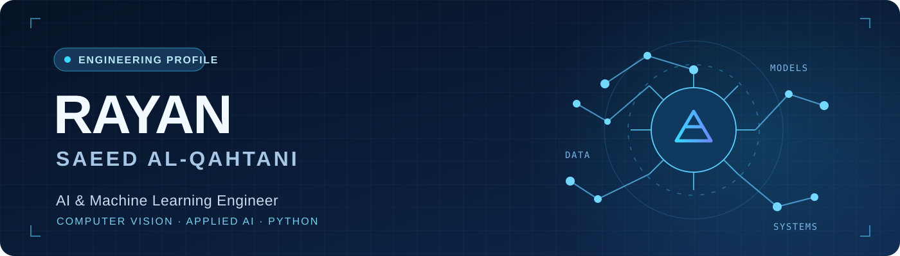

<div align="center">



<br/>

**Computer Engineering graduate building practical AI systems — from data to models to working applications.**

<a href="https://github.com/rayan-qh/saer"></a>
<a href="https://github.com/rayan-qh/AI-Enhanced-Intrusion-Detection-System-with-Risk-Assessment"></a>
<a href="mailto:rayan18q@gmail.com"></a>

<br/><br/>

`PYTHON` &nbsp;·&nbsp; `MACHINE LEARNING` &nbsp;·&nbsp; `COMPUTER VISION` &nbsp;·&nbsp; `APPLIED AI`

</div>

---

## 01 / The engineer behind the work

I’m **Rayan Saeed Al-Qahtani**, a **Computer Engineering graduate from King Khalid University (2026)** with a **4.03 / 5 GPA**.

I focus on **AI and machine learning engineering**, particularly computer vision and practical model development. I enjoy the engineering work around a model as much as the model itself: preparing datasets, designing evaluation workflows, understanding failure cases, and making results useful through a working interface.

I completed a **200-hour AI Engineering Bootcamp (AIEP)** with **Olo Academy**, in collaboration with Saudi Arabia’s **Ministry of Communications and Information Technology (MCIT)** under the **Saifak Zaki (صيفك ذكي)** initiative.

> **My direction:** Entry-level AI / Machine Learning Engineering · Computer Vision Engineering  
> **Location:** Saudi Arabia · Open to opportunities nationwide

## 02 / Featured engineering work

### 🚘 SAER — AI-Powered Car Pricing & Recognition | سعّر

**Academic team project · Machine learning · Computer vision · Web application**

A fully Arabic platform exploring used-car price estimation from **vehicle specifications** and **images**, with a separate model path for **make/model recognition** and a web interface for market exploration.

<table>
<tr>
<td align="center" width="33%"><strong>2,742</strong><br/><sub>Historical vehicle listings</sub></td>
<td align="center" width="33%"><strong>13,416</strong><br/><sub>Images in research dataset</sub></td>
<td align="center" width="34%"><strong>94.58%</strong><br/><sub>Historical test Top-1 recognition accuracy</sub></td>
</tr>
</table>


**What I contributed**
- Collected and prepared vehicle-listing data for model development.
- Developed the **image-based vehicle make/model recognition component**, working with **DINOv2 + CLIP** representations and a joint make/model classifier.
- Evaluated the recognition results and documented model limitations.

**The engineering system:** A team-built solution combining **Python / scikit-learn**, an **Arabic React + TypeScript interface**, and model services delivered through **FastAPI**.

<a href="https://github.com/rayan-qh/saer"></a>
<a href="https://saer-rmsavg637.pages.dev/"></a>
<a href="https://github.com/rayan-qh/saer/blob/main/models/identity_current.json"></a>

<sub>**Evaluation note:** 94.58% is from a historical test split used during development, not an independent blind external evaluation. Results are not guaranteed on new vehicles or market data. The online model service may need time to start.</sub>

<br/>

### 🛡️ AI-Powered Network Attack Classification — IDS

**Intrusion Detection System (IDS) & Risk Assessment**  
Computer Engineering graduation team project · Applied machine learning · Model evaluation · Flask application

A complete academic project connecting **network-flow data classification**, **risk assessment**, and an interactive dashboard. The team used **Random Forest** for multiclass traffic classification, integrated **Snort** alerts, and presented the outputs in a **Flask** interface.

<table>
<tr>
<td align="center" width="33%"><strong>2,830,743</strong><br/><sub>Source dataset records</sub></td>
<td align="center" width="33%"><strong>78</strong><br/><sub>Input features</sub></td>
<td align="center" width="34%"><strong>0.97</strong><br/><sub>Historical test macro-F1</sub></td>
</tr>
</table>

<a href="https://github.com/rayan-qh/AI-Enhanced-Intrusion-Detection-System-with-Risk-Assessment">

</a>
<sub>Original project demonstration from the team's final presentation — click the image to open the repository.</sub>

**What I contributed**
- **Trained the machine-learning classification model**, applying supervised learning to structured network-flow data.
- Worked with the project’s training and evaluation workflow to understand class-level performance.
- Participated in a team project that connected model outputs to a practical risk-monitoring interface.

**The engineering system:** **Python · scikit-learn · Random Forest · CICIDS2017 · Snort · Flask**. The documented historical notebook uses a stratified 80/20 split with **566,149 test samples** grouped into six classes.

<table>
<tr>
<td width="50%" align="center"><strong>Model evaluation</strong><br/><sub>Historical confusion matrix</sub><br/>
<a href="https://github.com/rayan-qh/AI-Enhanced-Intrusion-Detection-System-with-Risk-Assessment/blob/main/docs/model-card.md"></a></td>
<td width="50%" align="center"><strong>System overview</strong><br/><sub>How data reaches predictions</sub><br/>
<a href="https://github.com/rayan-qh/AI-Enhanced-Intrusion-Detection-System-with-Risk-Assessment"></a></td>
</tr>
</table>

<a href="https://github.com/rayan-qh/AI-Enhanced-Intrusion-Detection-System-with-Risk-Assessment"></a>
<a href="https://github.com/rayan-qh/AI-Enhanced-Intrusion-Detection-System-with-Risk-Assessment/blob/main/docs/model-card.md"></a>
<a href="https://github.com/rayan-qh/AI-Enhanced-Intrusion-Detection-System-with-Risk-Assessment/blob/main/docs/reports/graduation-report.pdf"></a>

<sub>**Evaluation note:** The 0.97 macro-F1 refers to the historical **six-class notebook experiment**, not an external blind test or an independently retested deployment. The runtime bundle documents **five classes**; these metrics must not be applied to that bundle. The original project was built by a team, and the ML model training was my own contribution.</sub>

<br/>

---

## 03 / My engineering toolkit

| Area | Tools & experience |
| :-- | :-- |
| **Programming & data** | Python · SQL · Pandas · NumPy |
| **Machine learning** | scikit-learn · preprocessing · feature engineering · classification · regression · evaluation |
| **Computer vision** | image classification · embeddings · DINOv2 · CLIP |
| **Engineering workflow** | Git · GitHub · Jupyter · technical documentation · API integration |
| **Web integration** | React · TypeScript · FastAPI *(used in team application work)* |

**Learning foundation:** My AIEP coursework also covered **PyTorch, CNNs, transfer learning, NLP, transformers, LLMs, RAG, and multimodal AI**. I distinguish coursework exposure from independently delivered projects.

## 04 / How I think about building AI

```text
Understand the problem
       ↓
Prepare & examine the data
       ↓
Build a measurable baseline
       ↓
Train, evaluate & inspect errors
       ↓
Connect the model to an interface
       ↓
Document what works — and what does not
```

**Engineering is not only achieving a metric.** It is knowing what was measured, which data supported the result, which assumptions may fail, and how another engineer can understand the system.

## 05 / Education & training

| Year | Milestone |
| :-- | :-- |
| **2026** | **B.Sc. in Computer Engineering** — King Khalid University · **GPA 4.03 / 5** |
| **2026** | **AI Engineering Bootcamp (AIEP)** — Olo Academy · **200 training hours** |
| | In collaboration with **MCIT**, under the **Saifak Zaki (صيفك ذكي)** initiative |

## 06 / Let's connect

I am interested in opportunities where I can contribute to **AI/ML engineering**, develop stronger **computer vision systems**, and keep learning from real engineering challenges.

**[Email me](mailto:rayan18q@gmail.com)** &nbsp;·&nbsp; **[LinkedIn](https://www.linkedin.com/in/rayan-qh/)** &nbsp;·&nbsp; **[Explore my GitHub](https://github.com/rayan-qh)** &nbsp;·&nbsp; **[See SAER live](https://saer-rmsavg637.pages.dev/)**

<div align="center">

---

<sub>**Build carefully. Measure honestly. Make it useful.**</sub>

</div>
